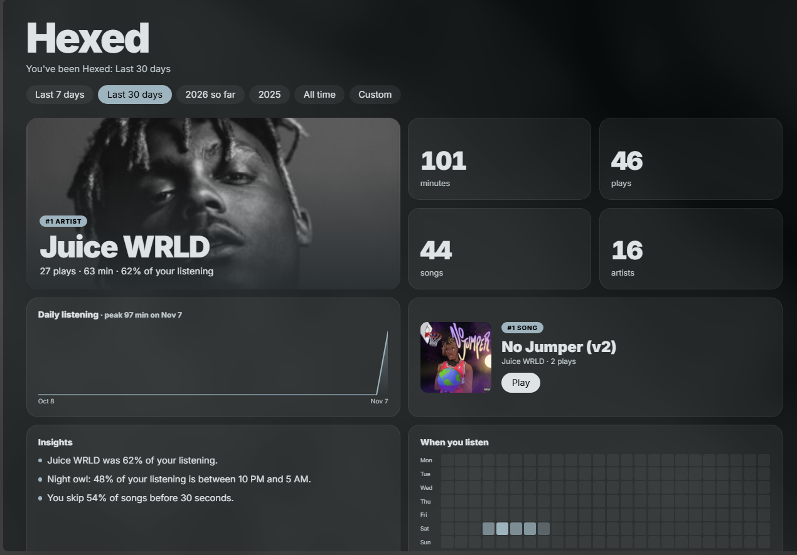

# Hexed

Your own Spotify Wrapped that you can open any day, for any time range, with real play counts.



Wrapped comes once a year and Spotify never shows how many times you've played a song. I wanted both, so Hexed
counts every play itself and turns it into a page I can check whenever I feel like it.

## What it does

- Counts every song you play in Spotify on your PC. 30 seconds or more is a play, like Spotify's own rule.
- Shows the count next to songs: "214 plays" in playlists, albums and the now-playing bar.
- Adds a **Hexed** page to the sidebar. Pick last 7 days, last 30 days, this year, last year, all time or your own
  dates, and you get:
  - your top artist, songs and albums, with covers
  - minutes, plays and how that compares to the period before
  - a chart of each day and a heatmap of when you listen
  - a few plain-words insights, like "Night owl: 97% of your listening is between 10 PM and 5 AM"
- Imports your full Spotify history, so your stats go back years and include plays from your phone.
- **Back up** saves everything to a file you can import again after reinstalling.

## Install

Copy this folder to `%APPDATA%\spicetify\CustomApps\hexed` (the `test` folder can stay behind), then

```powershell
spicetify config custom_apps hexed
spicetify apply
```

## Importing your history

1. Ask Spotify for your data at spotify.com → Account → Privacy settings → Download your data. Pick
   **Extended streaming history**. It can take up to a month to arrive by email.
2. Unzip it, open the Hexed page and click **Import**.
3. Pick the `Streaming_History_Audio_*.json` files (the quicker "Account data" files, `StreamingHistory_music_*.json`,
   work too).

Importing the same files twice is fine. Nothing gets counted double.

## Good to know

- It only sees what plays in Spotify on this PC. Phone listening shows up once you import your history.
- Spotify has no covers for local albums, so the Juice WRLD Sessions albums use a short hand-picked list of covers
  (`HEXED_ALBUM_ART` in `index.js`).

## For development

`core.js` holds the logic (import, stats, insights) and has tests: `node --test test/core.test.js`. `store.js` saves
plays in the browser database, `extension.js` is the tracker that always runs, and `index.js` is the page.
