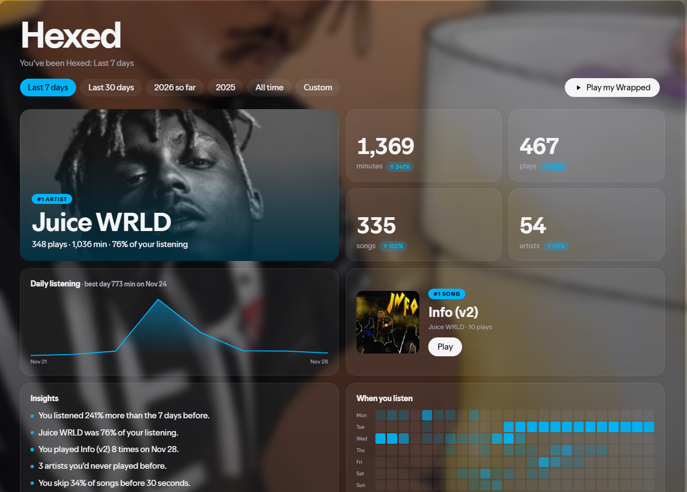
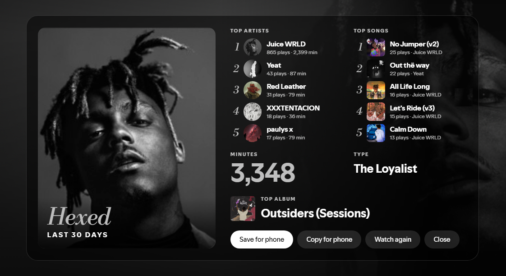

# Hexed

Your own Spotify Wrapped that you can open any day, for any time range, with real play counts.



Wrapped comes once a year and Spotify never shows how many times you've played a song. I wanted both, so Hexed
counts every play itself and turns it into a page I can check whenever I feel like it.

## What it does

- Counts every song you play in Spotify on your PC. 30 seconds or more is a play, like Spotify's own rule.
- Shows the count next to songs: "214 plays" in playlists, albums and the now-playing bar.
- Adds a **Hexed** page to the sidebar. Pick last 7 days, last 30 days, this year, last year, all time or your own
  dates, and you get:
  - your top artist, songs and albums, with covers
  - minutes, plays and how that compares to the period before
  - a chart of your listening, where moving along it shows the minutes, plays, top song and top artist for that day or week
  - a heatmap of when you listen
  - a few plain-words insights, like "Night owl: 97% of your listening is between 10 PM and 5 AM"
- **Play my Wrapped** turns the range you picked into a full-screen story, like Spotify Wrapped. Each slide plays
  one of your songs (local files too): minutes, a quick "guess your #1 song" quiz, your top songs and artists, a
  race for the #1 spot, your top album, your biggest days, a new favourite, your day in music, how much was your own
  files, your listening type, and a summary at the end. Any slide can be saved or copied as a picture.
- Imports your full Spotify history, so your stats go back years and include plays from your phone.
- **Back up** saves everything to a file you can import again after reinstalling, and the page shows how long it's been
  since your last one.

## Install

Copy this folder to `%APPDATA%\spicetify\CustomApps\hexed` (the `test` folder can stay behind), then

```powershell
spicetify config custom_apps hexed
spicetify apply
```

## Importing your history

1. Ask Spotify for your data at spotify.com → Account → Privacy settings → Download your data. Pick
   **Extended streaming history**. It can take up to a month to arrive by email.
2. Unzip it, open the Hexed page and click **Import**.
3. Pick the `Streaming_History_Audio_*.json` files (the quicker "Account data" files, `StreamingHistory_music_*.json`,
   work too).

Importing the same files twice is fine. Nothing gets counted double.

## Your Wrapped



Pick a range, then click **Play my Wrapped**. Click (or →) for the next slide, the left side (or ←) to go back, hold
the mouse or press Space to pause, Esc to close. Whatever you were listening to stops while it plays and comes back
where you left it when you close. The songs it plays don't count as plays.

The two buttons at the top right copy or save the slide you're on as a picture the size of your screen, so you can
keep any of them. Save asks where to put it; copy lets you paste it straight into a chat or post. On the last slide,
**Save for phone** and **Copy for phone** make a tall picture (1080×1920) instead: your top artists with their
photos, your top songs with their covers and play counts, your minutes, your top album and your listening type.

Artists and songs are ranked by plays (each time you listened 30 seconds or more), not minutes, so an artist with
short songs can rank above one you listened to longer.

## Good to know

- It only sees what plays in Spotify on this PC. Phone listening shows up once you import your history.
- Spotify's history download leaves local files out, so local plays only count from the day Hexed started tracking.
- Spotify has no covers for local albums, so the Juice WRLD Sessions albums use a short hand-picked list of covers
  (`HEXED_ALBUM_ART` in `index.js`).

## For development

`core.js` holds the logic (import, stats, insights, the Wrapped numbers) and has tests: `node --test test/core.test.js`.
`store.js` saves plays in the browser database, `extension.js` is the tracker that always runs, `index.js` is the page
and `story.js` is the Wrapped story.
