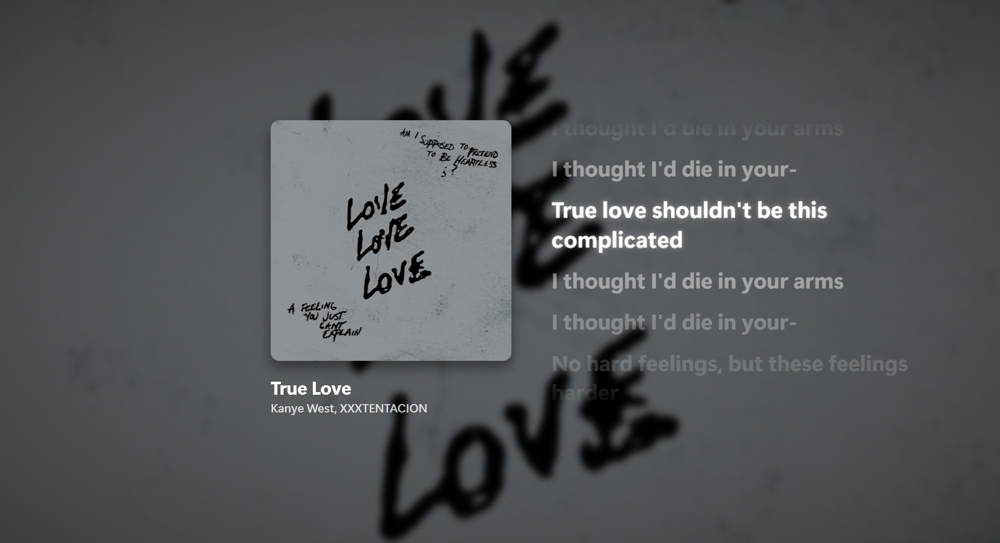

# Hexglass

My own Spotify look: the song's cover glows behind see-through panels, and the song shows up on my desktop with its
lyrics.



I wanted Spotify to look like whatever song is playing, and I wanted to glance at my desktop and see the song and
its lyrics. Live wallpaper apps always felt laggy to me, so this only moves when something actually changes.

## What it does

- **In Spotify:** the cover of the current song becomes a soft, blurred background behind see-through panels.
  Buttons, the heart and the play counts take their color from the cover, so everything shifts with the music.
- **A calmer home page:** no playlist descriptions, no little subtitles over each row, no podcast or audiobook rows.
- **On your desktop (Hexglass Desktop):** a small app shows the song behind your desktop icons, on every screen. You
  get the blurred cover, the cover itself, the title, the artist, and lyrics that scroll with the song, with the
  current line lit up.
- The lyrics always follow the song. When a window fills a screen, that screen skips the animations, since nobody
  can see them anyway.
- When Spotify closes, the app steps aside and your normal wallpaper comes back. It never swaps your wallpaper for
  something else.

## Install

You need [Spicetify](https://spicetify.app). For the desktop part you also need the
[.NET 8 SDK](https://dotnet.microsoft.com/download/dotnet/8.0) and the helper from
[LocalPresence](../LocalPresence/README.md) running, because the helper is what passes the song from Spotify to the app.

From the folder this repo is in:

1. The Spotify theme:

   ```powershell
   New-Item -ItemType Directory -Force "$env:APPDATA\spicetify\Themes\Hexglass" | Out-Null
   Copy-Item Hexglass\color.ini, Hexglass\user.css, Hexglass\theme.js "$env:APPDATA\spicetify\Themes\Hexglass\"
   spicetify config current_theme Hexglass color_scheme Base
   spicetify apply
   ```

2. The desktop app:

   ```powershell
   dotnet publish Hexglass\Desktop -c Release -o Hexglass\Desktop\bin\publish
   Start-Process Hexglass\Desktop\bin\publish\HexglassDesktop.exe
   ```

   After that it opens when Spotify opens and closes when Spotify closes, as long as
   [LocalPresence](../LocalPresence)'s helper is running. No startup shortcut needed.

## How to use it

Play something in Spotify, then show your desktop (Win+D, or the corner of the taskbar). The song is there, and the
lyrics follow along. To close the app, right-click its icon in the tray and pick Quit.

If you'd rather Spotify kept playing when you close its window, turn on **Close button should minimize the Spotify
window** in Spotify's settings, under Startup and window behaviour.

To go back to your old Spotify theme: `spicetify config current_theme <your old theme>`, then `spicetify apply`.

## Good to know

- Only songs with timed lyrics get the scrolling lines. Normal Spotify songs use Spotify's own lyrics. Local files use
  timed lyrics saved in [Spicy Lyrics](https://github.com/Spikerko/spicy-lyrics), which
  [VaultBridge](../VaultBridge/README.md) fills in. Anything else shows just the cover, title and artist.
- The desktop app sits behind your icons using the same trick as Lively and Wallpaper Engine. Windows doesn't
  officially support it, so a Windows update could break it until it's fixed.
- Windows doesn't redraw the desktop by itself when the app steps aside, so the app sets your own wallpaper picture
  again to bring it back. With a slideshow or a solid colour it leaves things alone, and the last song may stay on
  screen until your wallpaper next changes.
- The app uses about 130 MB of RAM. It sits still between songs and lines, and changes happen instantly instead of
  animating when a window covers the whole screen.
- `spicetify apply` restarts Spotify, so your music stops for a few seconds.

## For development

- `theme.js` draws the cover wash, picks the accent color, and sends the playing song, its cover and its lyrics to
  the helper. `user.css` is the glass look and the calmer home page. `color.ini` holds the base colors.
- `Desktop/Program.cs` is the desktop app (C#, WPF). It gets the song from the helper on `127.0.0.1:47999` and draws
  one window per screen behind the icons.
- Tests: `node --test test/accent.test.js` here, and `HexglassDesktop.exe --selftest` for the app (exit code 0 means
  it passed).
