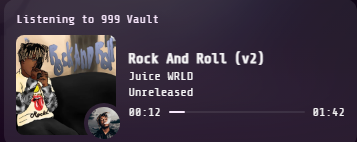

# LocalPresence

A real Discord status for local files: the song, the artist, the actual cover and a progress bar, instead of
Spotify's grey "?".



Most of what I play is local files (unreleased Juice WRLD), and Spotify's Discord status has no cover for those. It
just shows a question mark. LocalPresence shows them properly, and leaves normal Spotify songs alone.

## What it does

- **Local songs** get their own status: title, artist, album, cover and progress bar, with a small round picture of
  Juice WRLD in the corner on his songs. Under your name in the member list it shows the artist, or "Paused".
- **Normal Spotify songs** keep Spotify's own status, Listen Along included.
- **Covers** come from the best place it can find: the 999 Vault archive for Juice WRLD songs, then the Sessions
  album covers, then the song's cover on Spotify, then the artist's photo.

The status shows up as "Listening to 999 Vault", because it uses 999 Vault's Discord app.

## How it works

Discord gets Spotify's status from Spotify's servers, and no extension can change that. So while a local song plays,
LocalPresence turns on Spotify's **private session**, which stops Spotify sending the "?", and a small helper program
shows the status straight to the Discord app on your PC. When a normal song comes back, private session goes off
again. You'll see the lock icon in Spotify come and go; that's it working.

## Install

You need [Node.js](https://nodejs.org) and the Discord desktop app.

1. Add the extension to Spicetify:

   ```powershell
   copy localpresence.js "$env:APPDATA\spicetify\Extensions\"
   spicetify config extensions localpresence.js
   spicetify apply
   ```

2. Start the helper. To try it, run `node helper\helper.js` in a terminal and keep it open. To have it start on its
   own whenever you log in, with no window: press Win+R, type `shell:startup`, and in that folder make a shortcut to

   ```text
   conhost.exe --headless node "C:\path\to\LocalPresence\helper\helper.js"
   ```

   with your real path in it. Double-click the shortcut once to start it now.

## Good to know

- If you skip from a normal song straight to a local one, Spotify's card for the skipped song stays up until that
  song would have ended. Spotify doesn't let anything take it down early.
- A private session you turn on yourself while Spotify is open is left alone. One that's already on when Spotify
  starts gets switched off at the next normal song.
- If 999 Vault is playing music at the same time, the two share one Discord status and the latest one wins.
- To use your own Discord app instead of 999 Vault's, set the `NINE_DISCORD_ID` environment variable to its id.

## For development

- `localpresence.js` is the Spotify extension: local or not, private session, finding a cover.
- `helper/helper.js` is the helper (Node, no packages). It takes the status from Spotify on `127.0.0.1:47999`, only
  from the Spotify page, and passes it to Discord. It writes what it does to `helper/helper.log`.
- `helper/desktop.js` also passes the playing song on to [Hexglass Desktop](../Hexglass/README.md), the app that
  shows it behind the desktop icons.
- `assets/` has the corner pictures, uploaded to the Discord app as `juice`, `juice_mid` (in use) and `juice_wide`.
- Tests: `node --test test/core.test.js`.
