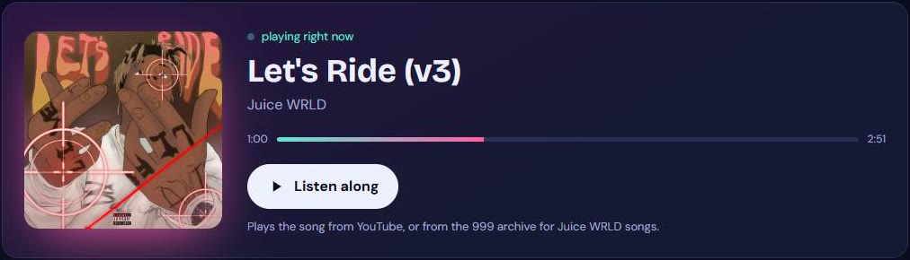

# SiteNow

Shows what I'm playing on Spotify on my website, live, local files included.



## Why I made it

My site has a Listening tab. I first fed it from Last.fm, but Spotify only tells Last.fm about a song after it's
played, and never about local files, which is most of what I listen to. So the site was always behind, or showing
the wrong song.

## What it does

- Once a song has played for 15 seconds, my site shows it as playing right now, with a progress bar. Skipping
  through songs sends nothing.
- Pausing, playing again and jumping around in a song show up on the site right away.
- Local files work too. For Juice WRLD songs the site finds the cover in the 999 archive.
- One click in Spotify's profile menu ("Share what I play on my site") turns it off, and the site goes back to my
  Last.fm history.

## Install

You need [Spicetify](https://spicetify.app).

```powershell
copy sitenow.js "$env:APPDATA\spicetify\Extensions\"
spicetify config extensions sitenow.js
spicetify apply
```

The first time Spotify opens with it, a window shows a token. Add it to the site's Cloudflare project as a secret
called `PUSH_TOKEN`, then redeploy the site. The profile menu has "SiteNow token" if you need to see it again.

## Good to know

- It's made for my site and sends to `itsreallyhex.pages.dev`. To use it with yours, change `ENDPOINT` at the top of
  `sitenow.js` and give your site an endpoint that takes the same JSON with the token.
- Only Spotify on this PC counts. Songs I play on my phone don't show live.
- When a Spotify update knocks Spicetify out, the site stops updating until `spicetify backup apply`.
- Keep the token private. With it, anyone could change what the site says you're playing.

## For development

- `sitenow.js`: the core (when to send, what to send) on top, the Spotify part below it.
- Tests: `node --test test/core.test.js` from this folder.
