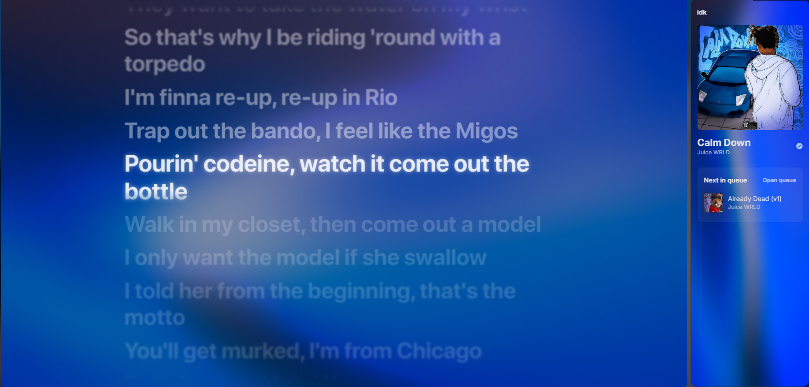

# VaultBridge

The Spotify side of my app [999 Vault](https://github.com/itsreallyhex/999-vault): new songs go to the top of a playlist, and every local song gets lyrics.



999 Vault is my Juice WRLD archive app. Its "Send to Spotify" button copies songs into Spotify's local files folder,
tagged with the era as the album. VaultBridge picks them up from there, so a song I send shows up where I'll find it,
with lyrics, without me doing anything.

## What it does

- **New songs to the top of `idk`.** When a new local file appears in Spotify, it goes to the top of my `idk`
  playlist, newest first. The very first time it runs, it only takes note of what's already there and moves
  nothing.
- **Lyrics for local files.** Instead of "No lyrics for local files", every local song gets lyrics in Spicy Lyrics.
  It tries, in order:
  1. timed lyrics from [juicewrldapi.com](https://juicewrldapi.com) for Juice WRLD songs, for the exact version
     (v1, v2...) and only when its length matches your file, so unreleased songs scroll with the song too
  2. timed lyrics from [LRCLIB](https://lrclib.net)
  3. plain lyrics from LRCLIB
  4. plain lyrics from juicewrldapi.com, which is also what a long session take gets when only the shorter song's
     lyrics exist (the timing wouldn't fit)

  juicewrldapi.com is the one I trust most, so its timed lyrics replace anything, even lyrics you uploaded to Spicy
  Lyrics yourself. Your upload is kept in Spotify's storage under `vaultbridge:replaced` in case you want it back.
  The other sources never replace your uploads. Every song gets looked at again every two weeks, so new lyrics on
  either site show up by themselves.

## Install

For the lyrics you'll want Spicy Lyrics, from the Spicetify Marketplace. Then copy VaultBridge into Spicetify and
apply:

```powershell
copy vaultbridge.js "$env:APPDATA\spicetify\Extensions\"
spicetify config extensions vaultbridge.js
spicetify apply
```

## Good to know

- The playlist is fixed in the code (`TARGET` in `vaultbridge.js`). Change it to one of yours if you borrow this.
- It checks for new local files every 30 seconds.
- The lyrics are saved inside Spicy Lyrics' own storage. If a Spicy Lyrics update changes how that works, lyrics may
  stop showing until VaultBridge is updated. The playlist part keeps working either way.

## For development

Everything is in `vaultbridge.js`. Its lyrics and playlist logic has tests: `node --test test/core.test.js`.
